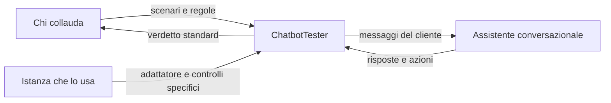

## In una frase

ChatbotTester interpreta un cliente davanti a un assistente conversazionale e restituisce il verdetto standard di collaudo.

## Il problema che risolve

Un assistente conversazionale può rispondere bene, ma compiere un'azione sbagliata.
Può anche chiedere dati personali prima della verifica.
Controllare ogni conversazione a mano richiede tempo e lascia risultati difficili da confrontare.
ChatbotTester esegue scenari ripetibili e controlla risposte, verifiche e azioni prodotte.
Restituisce un risultato comune, utile per capire se il bot può proseguire nel collaudo.
Il motore resta generico e non contiene conoscenze di una singola organizzazione.

## Un esempio concreto

Maria scrive a un assistente per chiedere assistenza su una pratica.
Lo scenario prevede che Maria alleghi un documento e riceva un riepilogo.
ChatbotTester invia i messaggi di Maria uno alla volta.
Poi controlla che l'assistente abbia creato una richiesta con il documento allegato.
Controlla anche che non abbia mostrato dati personali prima della verifica.
Se manca l'allegato, il risultato è bloccante.
Se una regola richiede ancora conferma, il risultato contiene un avviso.

## Chi lo usa

- **IT VUS COM**: collega il motore a un assistente e mantiene l'integrazione.
- **Chi collauda assistenti conversazionali**: prepara scenari e legge il verdetto.
- **Chi definisce le regole di servizio**: decide cosa deve accadere durante ogni conversazione.

## Come funziona, passo per passo

1. **Chi collauda definisce le persone fittizie, gli scenari e le regole.** Ogni scenario descrive una situazione e il comportamento atteso.
2. **L'istanza collega l'assistente.** Un adattatore traduce messaggi e risposte nella forma usata dal motore.
3. **ChatbotTester prepara l'ambiente.** Riparte da una situazione nota e separata per ogni prova.
4. **Il giocatore interpreta il cliente.** Usa frasi previste oppure propone la risposta successiva con un LLM.
5. **Il motore registra la conversazione e le azioni.** Legge anche codici di verifica ed effetti prodotti dall'assistente.
6. **Il giudice applica le regole.** Le regole controllano testi, ordine delle risposte e azioni effettuate.
7. **ChatbotTester costruisce il verdetto.** Indica esito, problemi bloccanti, avvisi e fonti non disponibili.

## Cosa deve fare

- **R1. Esegue ogni scenario con una situazione iniziale separata.** Si verifica: due prove consecutive non condividono messaggi o azioni.
- **R2. Controlla sia le risposte sia le azioni prodotte dall'assistente.** Si verifica: una richiesta senza allegato genera un problema nella prova prevista.
- **R3. Segnala come bloccante una violazione di una regola attiva e oggettiva.** Si verifica: uno scenario negativo della raccolta di riferimento produce esito bloccante.
- **R4. Non trasforma mai una regola da validare in un blocco.** Si verifica: la stessa violazione appare tra gli avvisi.
- **R5. Tratta il giudizio affidato a un LLM come avviso.** Si verifica: un giudizio negativo del LLM non crea problemi bloccanti.
- **R6. Restituisce non collaudato quando manca uno scenario o una fonte necessaria.** Si verifica: una raccolta vuota non restituisce mai ok.
- **R7. Non contiene riferimenti a organizzazioni o assistenti specifici nel nucleo.** Si verifica: il controllo di confine del progetto non trova quei riferimenti.
- **R8. Consente controlli specifici senza modificare il nucleo.** Si verifica: un controllo registrato dall'istanza valuta una regola locale.

## A che punto è

Al 19/11/2026 ChatbotTester è in sviluppo come strumento da riga di comando.
Il motore, le prove automatiche e gli esempi fittizi sono presenti nel repository.
Al 19/11/2026 non esistono ancora un'interfaccia per lo staff, un'API o un database.

## Cosa manca

- Distribuzione in ambiente di sviluppo per l'uso incorporato nella finestra Life (#1, sblocca IT VUS COM).
- API per usare il motore da altri strumenti; non esiste ancora una segnalazione aperta collegata.
- Interfaccia staff per preparare e consultare i collaudi; non esiste ancora una segnalazione aperta collegata.
- Database per conservare risultati e configurazioni; non esiste ancora una segnalazione aperta collegata.

## Con chi lavora

- **Vicky**: è il primo utilizzatore specifico da cui deriva il collaudatore generale.
- **L'istanza che usa ChatbotTester**: fornisce scenari, regole, persone fittizie e adattatore dell'assistente.
- **Il servizio di linguaggio della piattaforma Life**: può proporre messaggi del cliente e valutare regole testuali.
- **Fornitori esterni**: nessuno è collegato direttamente dal motore generico.

## Parole da sapere

- **Adattatore**: componente che fa dialogare ChatbotTester con un assistente dalla forma diversa.
- **API**: interfaccia usata da programmi diversi per scambiarsi richieste e risultati.
- **Assistente conversazionale**: programma che dialoga con una persona attraverso messaggi.
- **Bot**: altro nome per un assistente conversazionale.
- **Database**: archivio strutturato per conservare dati nel tempo.
- **Esito bloccante**: risultato che segnala una violazione e impedisce il collaudo positivo.
- **Interfaccia**: punto di contatto tra componenti o tra una persona e un programma.
- **Istanza**: uso di ChatbotTester configurato per un assistente specifico.
- **JSON**: formato testuale strutturato per scambiare dati tra programmi.
- **LLM**: modello linguistico che produce o valuta testo.
- **Nucleo**: parte generica del motore, priva di regole specifiche di un assistente.
- **Pacchetto**: insieme distribuibile di programmi e istruzioni necessarie al loro uso.
- **Python**: linguaggio di programmazione usato per costruire il motore.
- **Regola oggettiva**: controllo basato su dati osservabili, senza interpretazione linguistica.
- **Repository**: raccolta controllata del codice e della documentazione del progetto.
- **Scenario**: sequenza prevista di messaggi e condizioni per provare un caso.
- **Strumento da riga di comando**: programma avviato scrivendo istruzioni testuali in un terminale.
- **Verdetto standard**: risultato con esito, problemi bloccanti, avvisi e fonti non disponibili.
- **YAML**: formato testuale leggibile per descrivere configurazioni strutturate.

## Dettaglio tecnico

- Il motore è scritto in Python e distribuito come pacchetto da riga di comando.
- Non usa un database. Configurazioni e scenari restano nell'istanza che adotta il motore.
- Le configurazioni sono espresse in YAML. Il formato separa regole, scenari e persone fittizie.
- L'adattatore generico scambia messaggi nel formato JSON. Altri assistenti usano un adattatore dedicato.
- Il nucleo separa conversazione, ambiente, giocatore e giudice tramite interfacce precise.
- Gli esempi usano finti controllati, per provare il motore senza un assistente reale.
- Il rilascio consiste nel pacchetto e nelle prove automatiche. Non è previsto un rilascio su infrastruttura operativa.
